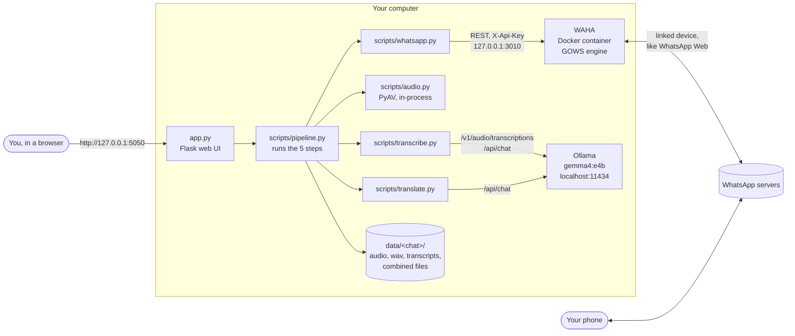
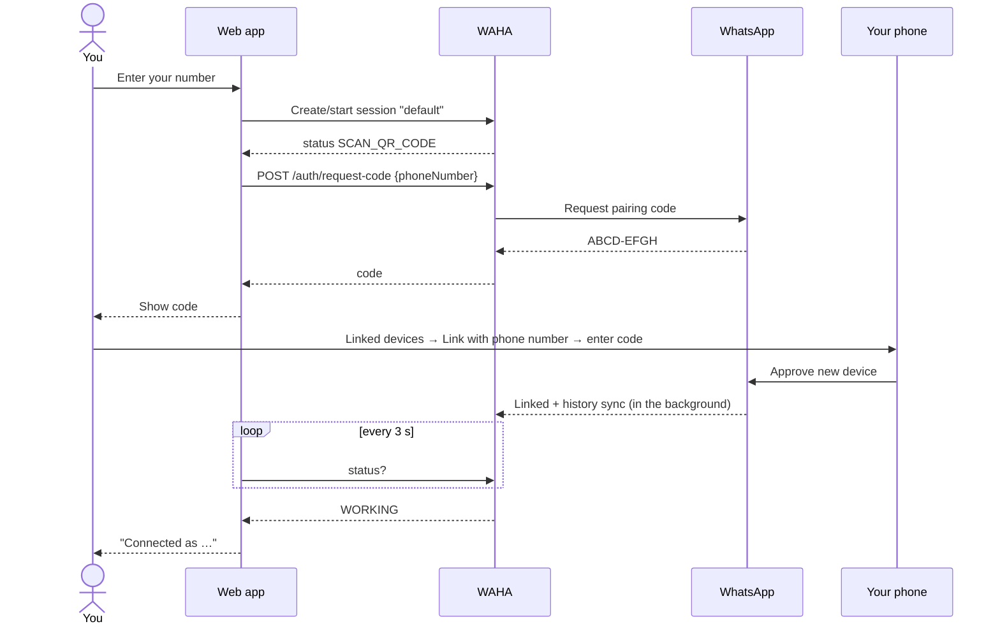
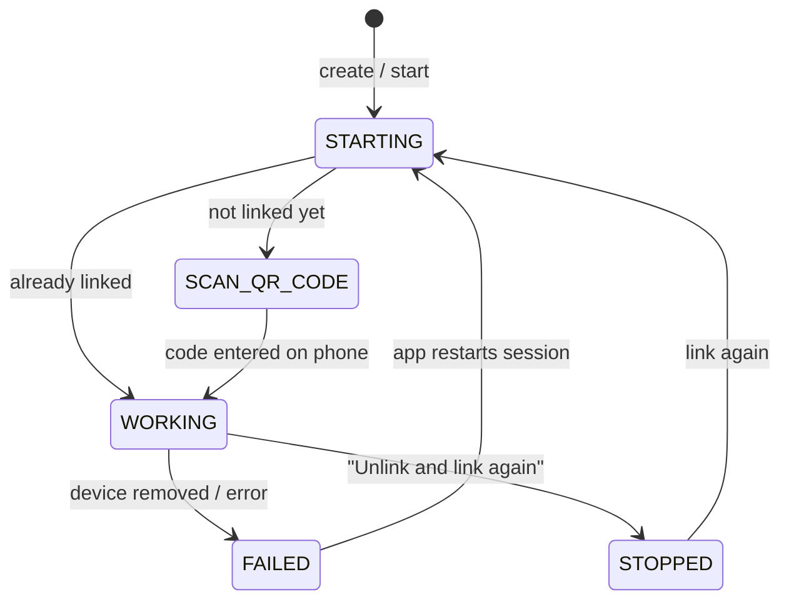
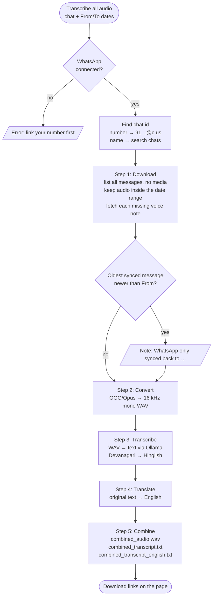
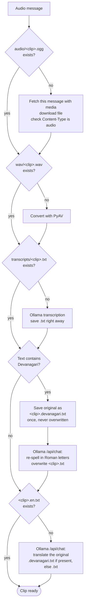
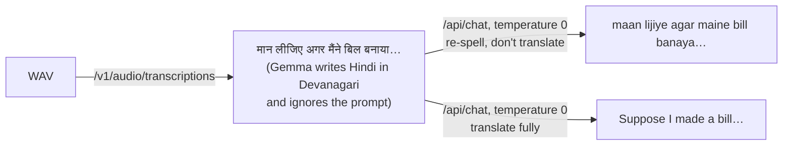
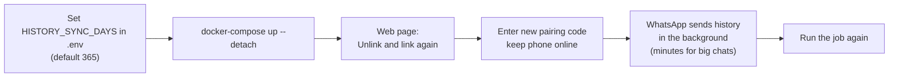
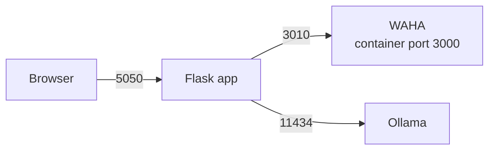
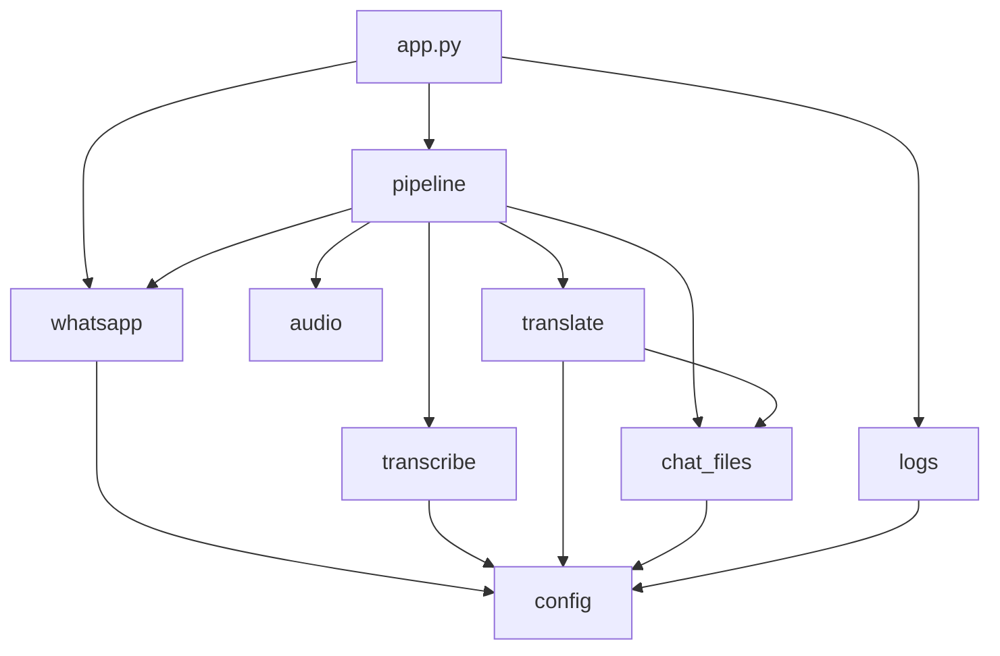

# WhatsApp Audio Transcript

A small local web app that turns the voice notes in a WhatsApp chat into text.

You enter your WhatsApp number and the chat you want (a phone number or a chat/group name). The app then:

1. downloads every voice note in that chat within a date range (by default the last 365 days),
2. transcribes each one into **Hinglish** (Hindi words in Roman letters, English words in English) with a **local Ollama model**,
3. translates each one into **English** with the same local model,
4. joins all clips into **one audio file** and all texts into **one Hinglish file and one English file**, labelled by date, time, and sender.

Everything runs on your own computer. Audio and text never go to a cloud service.

> **Docs in this repo**
> - [`PRODUCT.md`](PRODUCT.md): what the app does, from a user's point of view
> - [`STRUCTURE.md`](STRUCTURE.md): what each file is for
> - [`DECISIONS_LOG.md`](DECISIONS_LOG.md): every decision and change, with reasons and test results

---

## Contents
- [How it works](#how-it-works)
- [Requirements](#requirements)
- [Setup](#setup)
- [Usage](#usage)
- [Output files](#output-files)
- [Configuration](#configuration)
- [Logging](#logging)
- [Project structure](#project-structure)
- [Design notes](#design-notes)
- [Troubleshooting](#troubleshooting)
- [Limitations](#limitations)
- [Privacy and security](#privacy-and-security)

---

## How it works

### Architecture

Three local processes work together. Only WAHA talks to the internet, and only to WhatsApp.



| Part | What it is | Why |
|---|---|---|
| **Flask app** (`app.py`) | Web page with forms and a background job | The simplest readable web UI. It holds no business logic. |
| **Scripts** (`scripts/`) | All the real work, one job per file | They also run from the command line, without the browser. |
| **WAHA** | Self-hosted WhatsApp HTTP API in Docker | WhatsApp's official Business API can't read the history of personal chats. WAHA links as a device, the way WhatsApp Web does. |
| **Ollama** | Local model server | Transcription and translation stay on the machine. |
| **PyAV** | Python bindings to FFmpeg's libraries | Converts WhatsApp's OGG/Opus files to WAV with no ffmpeg install and no shell commands. |

### Linking your WhatsApp (once)



The login is stored in `waha_sessions/`, so you link only once. It survives restarts.

### WAHA session states



### One job: the 5 steps



Every step **skips work that is already on disk**. Running a chat again only processes new voice notes, and a crash in the middle loses nothing.

### What happens to one clip



### Why there are two Ollama calls per clip



The transcription endpoint has no setting for the output script, and Gemma ignores the prompt there, so a second text call does the re-spelling. The English translation starts from the **original** model output, so spelling slips in the Hinglish version are not carried over. See D4 and the "Hinglish" entry in [`DECISIONS_LOG.md`](DECISIONS_LOG.md).

---

## Requirements

| Need | Version | Check |
|---|---|---|
| macOS or Linux | Apple Silicon or Intel | |
| Python | 3.10+ | `python3 --version` |
| Docker + Compose | any recent | `docker-compose version` or `docker compose version` |
| Ollama | **0.40.12 or newer** (it has the `/v1/audio/transcriptions` endpoint) | `ollama --version` |
| Ollama model with audio input | `gemma4:e4b` (about 9.5 GB) | `ollama list` |

No ffmpeg install is needed. The `av` package ships the decoders.

---

## Setup

```bash
# 1. Settings
cp .env.example .env
#    Set WAHA_API_KEY to a long random value, for example:
python3 -c "import secrets; print(secrets.token_hex(24))"

# 2. WhatsApp API (WAHA) in Docker
#    Apple Silicon uses the image tag gows-arm (the default). On Intel/AMD, change it to gows in docker-compose.yml.
mkdir -p waha_sessions waha_media      # create mount folders first (avoids a permission error)
docker-compose up --detach             # or: docker compose up -d

# 3. Local model
ollama pull gemma4:e4b

# 4. Python environment
python3 -m venv .venv
.venv/bin/pip install -r requirements.txt
```

Check that everything is up:

```bash
docker-compose ps                          # waha: running, 127.0.0.1:3010->3000
curl -s http://localhost:11434/api/tags    # Ollama answers
```

---

## Usage

### Web app

```bash
.venv/bin/python app.py
# open http://127.0.0.1:5050
```

1. **Link your WhatsApp.** Enter your number with country code and no `+` (e.g. `919876543210`), then press **Get pairing code**. On your phone, go to *Settings → Linked devices → Link a device → Link with phone number instead* and type the code. The page continues by itself.
2. **Choose a chat.** Enter their number (`919812345678`, `+91 98123-45678` also works) or a chat/group name (`Family`).
3. **Pick dates.** *From / to* default to one year ago until today. Both days count in full.
4. Press **Transcribe all audio** and watch the progress lines.
5. **Download** the combined audio, the Hinglish transcript, and the English translation.

### Command line

```bash
# Full job: last 365 days
.venv/bin/python -m scripts.pipeline --phone 919876543210 --chat "Family"

# Full job: a chosen date range
.venv/bin/python -m scripts.pipeline --phone 919876543210 --chat 919812345678 \
    --from 2025-01-01 --to 2025-06-30

# Translate only (chat already transcribed; WhatsApp and WAHA are not needed)
.venv/bin/python -m scripts.translate --chat "Family"
```

If you are not linked yet, the pipeline prints a pairing code and waits.

### Getting voice notes older than a few weeks

WhatsApp decides how much history it sends to a linked device, and it often sends only recent weeks. The page tells you when this happens: *"WhatsApp has only synced this chat back to …"*.



`docker-compose.yml` asks WhatsApp for a full sync limited to `HISTORY_SYNC_DAYS` days, using WAHA's experimental `WAHA_GOWS_DEVICE_*` settings. These only take effect when a device is linked, which is why you link again. Clips already processed stay on disk.

---

## Output files

```
data/<chat>/                                  <chat> = number or name, unsafe characters replaced by _
├── audio/<time>_<id>.ogg                     original voice notes from WhatsApp
├── wav/<time>_<id>.wav                       16 kHz, mono, 16-bit
├── transcripts/
│   ├── <time>_<id>.txt                       Hinglish transcript
│   ├── <time>_<id>.devanagari.txt            model's original output (only if it used Hindi script)
│   └── <time>_<id>.en.txt                    English translation
├── clips.json                                time + sender of each clip in the last run's date range
├── combined_audio.wav                        all clips, oldest first, 1 s of silence between them
├── combined_transcript.txt                   all Hinglish transcripts
└── combined_transcript_english.txt           all English translations
```

File names start with the message's Unix timestamp, so they sort by time. The message id keeps them unique and stable between runs.

Each part of the combined text files looks like this:

```
[2026-11-02 18:19] Me:
maan lijiye agar maine bill banaya na 90000 ka theek hai ...

[2026-11-02 18:22] 919812345678:
to basically kya hota hai for example you bought something from me ...
```

**To redo something**, delete that file and run again. For example, delete `<clip>.en.txt` to translate a clip again, or `<clip>.txt` to transcribe it again.

---

## Configuration

All settings live in `.env` (see `.env.example`). `scripts/config.py` reads them.

| Variable | Default | Used by | Meaning |
|---|---|---|---|
| `WAHA_URL` | `http://localhost:3010` | app, docker-compose | Where the app reaches WAHA. Also used as WAHA's `WAHA_BASE_URL`, so media links point to the right port. |
| `WAHA_API_KEY` | *(none, must be set)* | app, WAHA | Shared secret for WAHA's API. |
| `WAHA_SESSION` | `default` | app | WAHA session name. |
| `OLLAMA_URL` | `http://localhost:11434` | app | Ollama server. |
| `OLLAMA_MODEL` | `gemma4:e4b` | app | Model for transcription, Hinglish, and translation. It must accept audio. |
| `APP_PORT` | `5050` | app | Web app port. 5000 is avoided because macOS AirPlay Receiver uses it. |
| `DATA_DIR` | `data` | app | Output folder. |
| `LOG_DIR` | `logs` | app | Log folder. |
| `HISTORY_SYNC_DAYS` | `365` | docker-compose | Days of history WhatsApp is asked to send when linking. |

### Ports used



All three listen on `127.0.0.1` only, so nothing is reachable from the network.

---

## Logging

Logs go to the terminal and to `logs/app.log`, which rotates at 1 MB and keeps 3 old files. Every step and every clip is logged with its timing. Example (timings depend on your machine and clip length):

```
pipeline: Step 1/5: downloading audio messages from 2025-11-05 to 2026-11-05...
whatsapp: Read 105 messages in 0.2s (oldest from 2026-10-20): 3 are audio in the chosen dates
whatsapp: Audio 1/3 (1793623740_AC31….ogg): downloaded 96 KB in 2.4s
pipeline: Convert 1/3: done in 0.1s
pipeline: Transcribe 1/3: 678 characters in 25.3s
pipeline: Hinglish 1/3: converted from Devanagari in 3.8s
translate: Translate 1/3: 677 characters from devanagari.txt in 2.1s
pipeline: All done: 3 audio messages, 1m 44s of audio, total time 76.4s
```

Watch it live with `tail -f logs/app.log`.

**What is never logged:** full phone numbers or chat names (masked to the last 4 characters, e.g. `********9176`), transcript or translation text (only its length), the pairing code, and the API key.

---

## Project structure

```
whatsapp-audio-transcript/
├── app.py                 Flask web UI: routes, background job, error pages
├── scripts/
│   ├── config.py          Settings from .env
│   ├── logs.py            Logging setup + masking of numbers
│   ├── whatsapp.py        WAHA: link, find chat, list messages, download audio, logout
│   ├── audio.py           To WAV, join WAVs, clip length
│   ├── transcribe.py      Speech-to-text + Devanagari → Hinglish
│   ├── translate.py       → English (also a CLI)
│   ├── chat_files.py      Folder layout, clips.json, combined text files
│   └── pipeline.py        The 5 steps in order (also a CLI)
├── templates/             base.html, index.html, pairing.html
├── docker-compose.yml     WAHA container
├── requirements.txt       flask, requests, python-dotenv, av
├── .env.example           Settings template
├── README.md              This file
├── PRODUCT.md / STRUCTURE.md / DECISIONS_LOG.md
├── data/  logs/  waha_sessions/  waha_media/     created at runtime (git-ignored)
```

### Module dependencies



### Web routes

| Method | Path | Purpose |
|---|---|---|
| GET | `/` | Main page: link form, or chat + dates form, progress, and download links |
| POST | `/connect` | Start the WAHA session and show a pairing code |
| GET | `/connection-status` | Polled by the pairing page until the phone is linked |
| POST | `/start` | Start a job (chat, `date_from`, `date_to`) in a background thread |
| GET | `/job-status` | Polled every 3 s while a job runs |
| POST | `/relink` | Log out of WhatsApp so the next link syncs history again. Refused while a job runs. |
| GET | `/files/<path>` | Download output files. Paths outside `data/` are rejected. |

---

## Design notes

Short versions. The full reasoning, alternatives, and test results are in [`DECISIONS_LOG.md`](DECISIONS_LOG.md).

- **Messages are listed without media**, and each missing voice note is fetched on its own request. With media on, WAHA downloads every voice note on a page before it answers, and that timed out.
- **Media links are rewritten to `WAHA_URL`**. WAHA builds links with its container port (3000), which on this machine was another app. Rewriting also means the API key is only ever sent to WAHA.
- **Date filtering happens in the app** after listing all messages. Listing is fast, and it tells us the oldest synced date for the "only synced back to" warning.
- **All WAVs share one format** (16 kHz mono 16-bit), so joining them is just appending samples with Python's `wave` module.
- **One job at a time**, with plain module-level state. It is a personal tool, so a task queue would add a broker and nothing else.
- **Kept out on purpose:** database, user accounts, QR login, automated test suite.

---

## Troubleshooting

| Symptom | Cause | Fix |
|---|---|---|
| `unknown shorthand flag: 'd' in -d` | The Docker Compose plugin link is broken (e.g. it points to a removed Rancher Desktop) | Use `docker-compose up --detach`, or relink: `ln -sfn "$(brew --prefix)/opt/docker-compose/bin/docker-compose" ~/.docker/cli-plugins/docker-compose` |
| `no matching manifest for linux/arm64/v8` | Intel-only image on Apple Silicon | Use the `gows-arm` image tag (default) |
| `chown … waha_sessions: permission denied` | Docker can't create the mount folder | `mkdir -p waha_sessions waha_media` |
| "Can't reach WAHA" on the page | Container not running | `docker-compose up --detach` |
| "… did not answer like WAHA" | `WAHA_URL` points to another app | Fix `WAHA_URL` in `.env` |
| `Address already in use … Port 5000` | AirPlay Receiver, or an old copy of the app | The app now uses 5050. Stop old copies with `lsof -iTCP:5050 -sTCP:LISTEN`. |
| `Read timed out (read timeout=120)` | Old code downloaded media in bulk | Fixed. Restart `app.py`. |
| `[Errno 541478725] End of file` | Saved "audio" was actually an HTML page | Fixed. Delete bad files in `data/<chat>/audio/` and run again. |
| "Ollama can't transcribe with …" | Ollama too old, or model not pulled | Update Ollama (Mac app: download from ollama.com, don't use brew if it wasn't installed with brew), then `ollama pull gemma4:e4b` |
| `ollama pull` fails: "resolves to non-public 100.x.x.x" | A VPN, proxy, or router DNS maps the download host to a private address | Pull on another network, or turn off the VPN/proxy DNS for the download |
| "WhatsApp has only synced this chat back to …" | WhatsApp sent limited history | See [Getting voice notes older than a few weeks](#getting-voice-notes-older-than-a-few-weeks) |
| "Skipped, WhatsApp no longer has this media" | Old media was deleted from WhatsApp's servers | Nothing to do. The clip is skipped. |
| Transcript still in Hindi script | Text was written before the Hinglish step existed | Run the job again. It converts without transcribing again. |

---

## Limitations

- **History depth is decided by WhatsApp.** The app asks for a full sync, but WhatsApp may send less, and the WAHA settings for this are experimental.
- **Old media may be gone** from WhatsApp's servers. Those clips are skipped and noted in the log.
- **Quality depends on the model.** `gemma4:e4b` does well on Hindi/English mix. A bigger tag (`gemma4:12b`) may be more accurate but slower. Hinglish spelling is casual, so the same word can be spelled two ways ("toh" / "to").
- **Unofficial API.** WAHA works like WhatsApp Web. Use it only with your own account.
- **One job at a time**, one WhatsApp account, local use only.

---

## Privacy and security

- **Everything is local.** WAHA, Ollama, and the app listen on `127.0.0.1` only. Audio and text stay on your machine.
- **Secrets** stay in `.env` (git-ignored). The API key is sent only to `WAHA_URL`, and media links from WAHA are rewritten to that address.
- **Input is checked:** phone numbers must be 8–15 digits, chat input 1–100 characters, dates valid ISO dates in order. Chat ids are URL-encoded. Downloads can't escape `data/`.
- **Logs** mask numbers and names and never contain message text, codes, or keys.
- **Git-ignored:** `.env`, `data/`, `logs/`, `waha_sessions/` (your WhatsApp login), `waha_media/`, `.venv/`.
